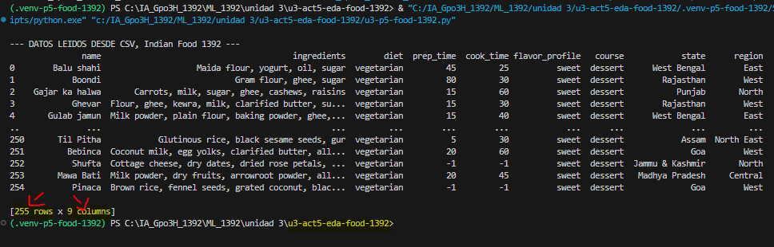
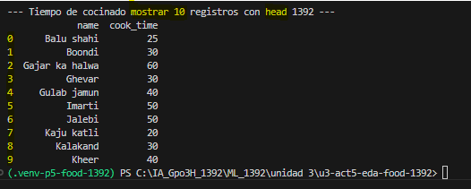
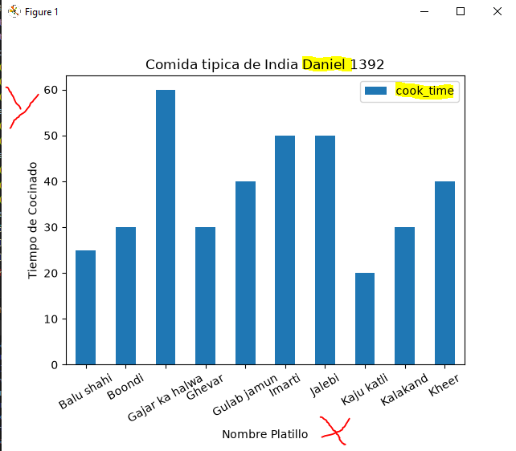
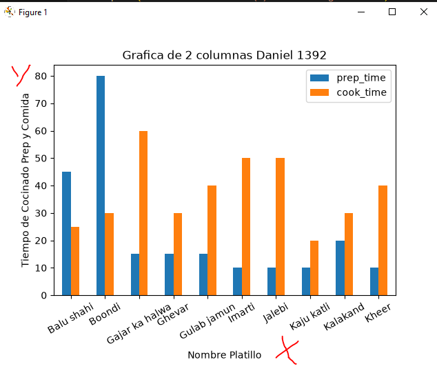
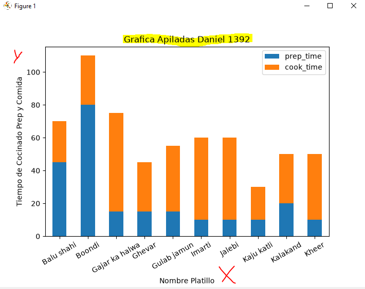

## Analisis exploratorio de datos
## Comida del pais India
## -+-+- Importando datos del archivo CSV comida india

## -+-+- Mostrar nombre comida + ingredientes

## Tiempo de cocinado mostrar 10 registros con head

## Creacion de grafica de barras 1392

## Grafica de 2 Columnas 

## Grafica de 2 Columnas Apiladas
